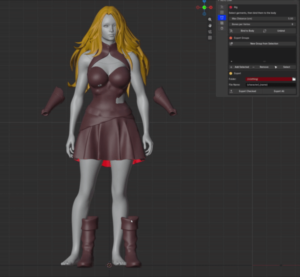
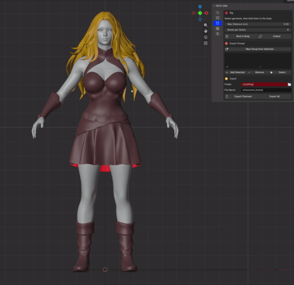
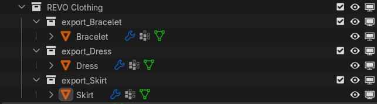
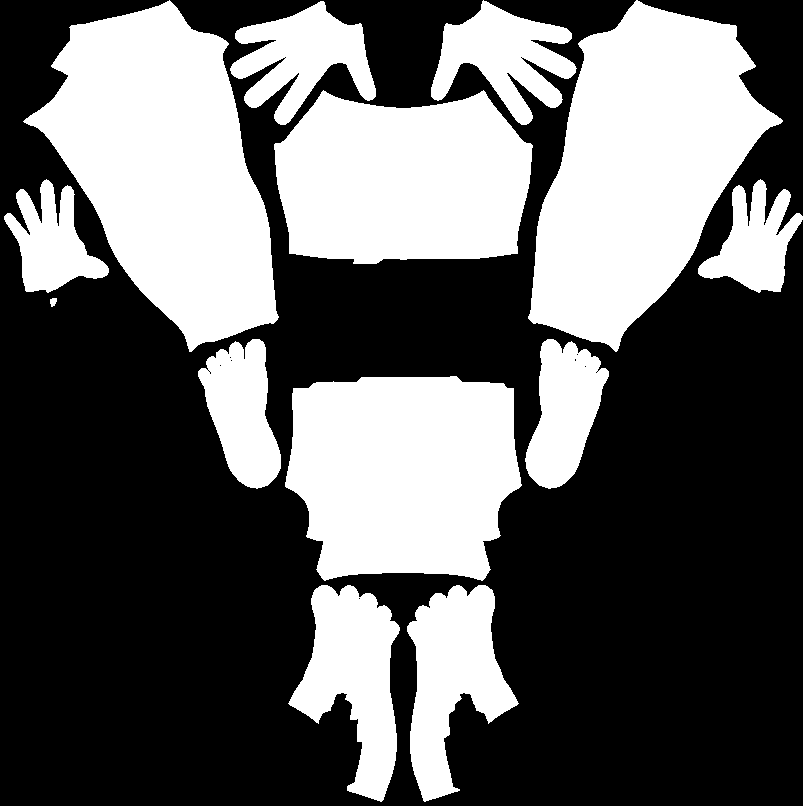

# Clothing

**Clothing is the third tab**, between Conform and Textures. Bind garments to your conformed character, group them, and export each group as its own FBX for Unreal.

## Bind garments

1. Model or fit the garments on the conformed character in its rest pose.
2. Select the garments and click **Bind to Body**.

Each garment gets the character's skeleton and skin weights copied from the nearest point on the body and head. Areas farther from the body than **Max Distance**, such as a skirt hem or a wide sleeve, are filled smoothly from the parts that sit close. This keeps them from snapping to the wrong limb. Where the garment bridges two body parts, such as a sleeve seam across the armpit, the weights are blended between them so the cloth doesn't tear when the arm moves. **Bones per Vertex** limits how many bones move each vertex; Unreal uses 8 by default.

Clothing uses only the MetaHuman body skeleton, so it never receives facial bone weights. Bind again after changing a garment's shape or the body.

**Unbind** removes the selected garments from the skeleton: their skin weights, Armature modifier and parent. Garments stay where they are and keep any vertex groups of your own. The character's own body and head are never unbound.

{.doc-screenshot}

## Check the bind

Play a body animation to see the garments move with the character. Open **MetaHuman Tools > Animation**, choose a body ROM clip such as `mhc_body_rom_body` and click **Load Clip**, then play or scrub the timeline. Look for skin poking through and for stretching at the shoulders, elbows, hips and knees. **Unload ROM** returns the character to its rest pose.

{.doc-screenshot}

Garments following a body ROM clip

A loaded clip changes nothing else: Bind always uses the rest shape, and Export always writes the rest pose. See [Load a clip](metahuman/animation.md#load-a-clip) and [where to get ROM files](metahuman/rom-files.md).

## Export groups

An export group is a collection named `export_<name>`, for example `export_shoes`. Collections you name this way yourself appear in the list too.

- **New Group from Selection** puts the selected garments in a new group.
- **Add Selected** and **Remove** move the selection into or out of the group chosen in the list.
- **Select** selects the group's meshes.
- The checkbox next to a group includes it in **Export Checked**.

All groups are kept under a **REVO Clothing** collection, so you can hide or show every garment at once.

{.doc-screenshot}

## Export

Choose a **Folder** and a **File Name** pattern. `{character}` is the character name and `{name}` is the group name after `export_`, so `{character}_{name}` writes `MHC_Rin_shoes.fbx`.

**Export Checked** writes the ticked groups; **Export All** writes every group. Each FBX contains that group's meshes and the MetaHuman body skeleton, in centimetres and with Unreal's joint orientation, ready to import onto the MetaHuman body skeleton. Your scene is not changed by exporting.

The clothing only lines up in Unreal if the character there is your exported DNA. In MetaHuman Creator, import the DNA with **Replace**, not **Mesh Fit**.

## Body masks

With **Body Masks** on, each export also saves masks beside the group's FBX, such as `MHC_Character_shoes_BodyMask.png`. Each uses that mesh's UV layout: black where the group covers it, white where skin shows. A group that also covers part of the head, such as a dress or a collar over the neck, gets a `_HeadMask.png` too. In Unreal, use them to hide the body and head under the clothes so skin can't poke through.

- **Cover Distance** hides skin with cloth this close outside it. Shoes and sleeves that surround the skin hide it however far the cloth sits, and skin poking through the cloth is hidden too.
- **Safety Margin** keeps hidden skin this close to visible skin visible, so the body still overlaps the cloth at openings such as boot tops and cuffs.
- **Mask Size** sets the image width and height in pixels.
- **Padding** sets how many pixels each UV island's colour grows past its edge, so texture filtering and mipmaps don't pull in the wrong colour. Raise it if a seam shows at a distance.

To check a mask, choose the group in the list:

- **Preview on Body** hides the body and head where the group covers them, as Unreal will, so you can see the clothes on the masked character. Click it again to show the whole body. Nothing is saved.
- **Create Mask** makes the mask images without exporting. View them in an Image Editor.

{.doc-screenshot}

Generated body mask example
