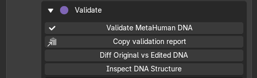
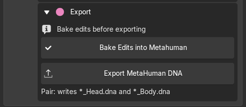

# Export MetaHuman DNA

1. **Apply** any Conform preview to the imported Source.
2. **Unweld Neck Seam** if you used a joined sculpt.
3. Check the neutral face, lower LODs and facial movement.
4. In **Export**, click **Bake Edits into Metahuman** for each edited DNA mesh.
5. Click **Validate MetaHuman DNA** and resolve reported problems.
6. **Export MetaHuman DNA** to a new filename, then check it in Unreal.

{.doc-screenshot .tool-ui-screenshot}

Validate the character before export

**Bake before exporting.** Apply commits the Conform result to the mesh; Bake prepares the edited character for DNA export.

{.doc-screenshot .tool-ui-screenshot}

Bake edits, then export MetaHuman DNA

Keep the original DNA and the `<file name>_revo_mh` folder next to your .blend; export reads the original DNA copy stored there. Head and body export as separate DNA files. A combined DNA is for inspection only.

**In MetaHuman Creator, import your DNA with Replace, not Mesh Fit.** Replace uses the DNA exactly as exported. Mesh Fit fits MetaHuman Creator's own body to your mesh instead, so shapes far from a standard MetaHuman come out slightly different, and clothing made in Blender can clip through at the crotch and shoulders.

ROM clips are not included in DNA export. Textures must be saved separately from the [Textures tab](../textures.md).

If export reports a problem, open **REVO DNA Export Report** in Blender's Text Editor.
