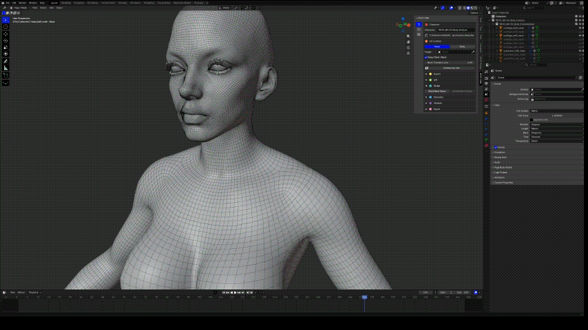
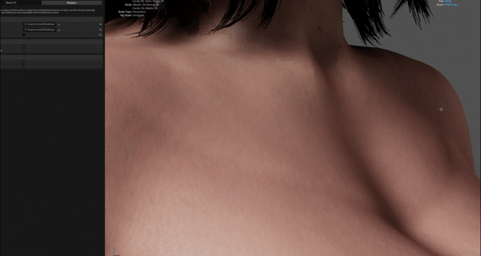

# Sculpt

Sculpt the imported **LOD0 head or body**. Keep the vertex count and connections unchanged: do not remesh, use Dyntopo, or add/delete vertices.

## Sculpt across the neck

{.doc-screenshot .tool-ui-screenshot}

Weld and Unweld Neck Seam

1. Align the head and body.
2. Click **Weld Neck Seam** to join them temporarily.
3. Sculpt across the seam.
4. Click **Unweld Neck Seam** to return to separate meshes.

After Unweld, the neck seam keeps the smooth shading it had while welded.

{.doc-screenshot}

Join the neck seam for sculpting

Repeat as needed. After sculpting, check lower LODs and facial movement.

## Fix a ridge at the neck seam

If you see a ridge or dent along the chest-cut after importing into MetaHuman Creator, smooth it in Blender across the welded seam:

1. Click **Weld Neck Seam**.
2. Use the **Smooth** brush on the ridge, working across the seam rather than along it.
3. Click **Unweld Neck Seam**.
4. In **Export**, click **Bake Edits into Metahuman** for both the head and the body, then **Export MetaHuman DNA**.
5. Import the new DNA into MetaHuman Creator with **Replace** and check the chest again.

{.doc-screenshot}

The ridge in MetaHuman Creator, smoothed across the welded seam, and the result after importing again

Before exporting, open **Export** and **Bake Edits into Metahuman** for each edited DNA mesh. See [export steps](export.md).
